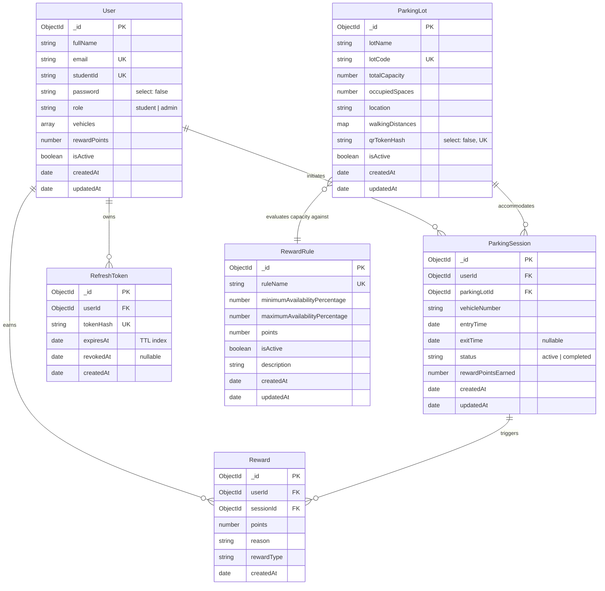

# PARKWISE — Database Schema & Data Architecture Specification

## 1. Architectural Overview

PARKWISE leverages **MongoDB** via the **Mongoose ODM** (v8.9+) in Node.js (ES Modules). The database architecture is designed specifically for high-concurrency campus parking scenarios with rapid touchless QR check-in/out operations, live occupancy tracking, and an incentive rewards engine.

### Core Collections
1. **`users`** — Registered student and administrator accounts.
2. **`parkinglots`** — Campus two-wheeler parking lots, capacities, and layout data.
3. **`parkingsessions`** — Real-time and historical parking duration records.
4. **`rewards`** — Immutable point award transaction ledger.
5. **`refreshtokens`** — Cryptographic refresh token storage for JWT session rotation.
6. **`rewardrules`** — Configurable tier thresholds mapping parking lot availability percentages to incentive points.

---

## 2. Entity-Relationship Model



---

## 3. Detailed Collection Specifications

### 3.1. `users` Collection (Model: `User`)

Stores identity credentials, student numbers, registered vehicle license plates, and aggregated reward balances.

| Field | Type | Required | Constraints / Defaults | Description |
|---|---|---|---|---|
| `_id` | `ObjectId` | Yes | Auto-generated PK | Unique user record identifier |
| `fullName` | `String` | Yes | Trimmed, 2–100 chars | Full legal name of student or staff |
| `email` | `String` | Yes | Unique, lowercase, trimmed | Institutional campus email (`@campus.edu`) |
| `studentId` | `String` | Yes | Unique, uppercase, trimmed | University matriculation / ID code |
| `password` | `String` | Yes | `select: false` | Bcrypt password hash (excluded by default) |
| `role` | `String` | Yes | Enum: `['student', 'admin']`, default: `'student'` | Access role for authorization |
| `vehicles` | `Array` | No | Default: `[]` | List of registered two-wheeler vehicles |
| `vehicles[].vehicleNumber` | `String` | Yes | Normalized, uppercase, trimmed | License plate / campus tag number |
| `vehicles[].vehicleType` | `String` | Yes | Enum: `['two-wheeler', 'bicycle', 'other']` | Vehicle class |
| `vehicles[].isPrimary` | `Boolean` | No | Default: `false` | Primary commuter vehicle flag |
| `rewardPoints` | `Number` | No | Min: `0`, Default: `0` | Cached total points balance |
| `isActive` | `Boolean` | No | Default: `true` | Account suspension / active flag |
| `createdAt` / `updatedAt` | `Date` | Yes | Auto (Mongoose timestamps) | Document audit timestamps |

#### Serialization Security
Default `toJSON` and `toObject` transform hooks explicitly delete the `password` hash and `__v` version key, preventing sensitive leakage.

---

### 3.2. `parkinglots` Collection (Model: `ParkingLot`)

Represents physical campus parking locations, total capacity, and layout metadata.

| Field | Type | Required | Constraints / Defaults | Description |
|---|---|---|---|---|
| `_id` | `ObjectId` | Yes | Auto-generated PK | Unique lot identifier |
| `lotName` | `String` | Yes | Trimmed, 3–100 chars | Human-readable lot title |
| `lotCode` | `String` | Yes | Unique, uppercase, trimmed | Short campus code (e.g., `'A'`, `'B'`) |
| `totalCapacity` | `Number` | Yes | Min: `1` | Physical parking bays available |
| `occupiedSpaces` | `Number` | No | Min: `0`, Max: `totalCapacity`, Default: `0` | Real-time occupied vehicle count |
| `location` | `String` | No | Trimmed | Campus zone / quadrangle description |
| `walkingDistances` | `Map<Number>` | No | Default: `{}` | Map of academic block distances (in meters) |
| `qrTokenHash` | `String` | Yes | Unique, `select: false` | SHA-256 hash of lot entrance verification QR |
| `isActive` | `Boolean` | No | Default: `true` | Operational status of the parking lot |
| `createdAt` / `updatedAt` | `Date` | Yes | Auto (Mongoose timestamps) | Document audit timestamps |

#### Dynamic Virtuals (Zero Data Redundancy)
- `availableSpaces`: Calculated on-the-fly as `Math.max(0, totalCapacity - occupiedSpaces)`.
- `occupancyPercentage`: Calculated as `Math.round((occupiedSpaces / totalCapacity) * 100)`.
- `availabilityPercentage`: Calculated as `Math.round((availableSpaces / totalCapacity) * 100)`.

---

### 3.3. `parkingsessions` Collection (Model: `ParkingSession`)

Tracks touchless QR check-in events, active parking durations, check-out timestamps, and reward calculations.

| Field | Type | Required | Constraints / Defaults | Description |
|---|---|---|---|---|
| `_id` | `ObjectId` | Yes | Auto-generated PK | Unique session identifier |
| `userId` | `ObjectId` | Yes | Ref: `User` | Commuting student reference |
| `parkingLotId` | `ObjectId` | Yes | Ref: `ParkingLot` | Parking lot reference |
| `vehicleNumber` | `String` | Yes | Trimmed, uppercase | Vehicle used during this session |
| `entryTime` | `Date` | Yes | Default: `Date.now` | Check-in timestamp |
| `exitTime` | `Date` | No | Default: `null` | Check-out timestamp |
| `status` | `String` | Yes | Enum: `['active', 'completed']`, Default: `'active'` | Session state |
| `rewardPointsEarned`| `Number` | No | Min: `0`, Default: `0` | Points awarded upon check-out |
| `createdAt` / `updatedAt` | `Date` | Yes | Auto (Mongoose timestamps) | Document audit timestamps |

#### Pre-Validate Integrity Hook
- If `status === 'completed'`, `exitTime` is strictly required.
- `exitTime` cannot be earlier than `entryTime`.

#### Virtual
- `durationMinutes`: Real-time or final elapsed parking time in minutes.

---

### 3.4. `rewards` Collection (Model: `Reward`)

An append-only ledger recording all incentive points granted to students.

| Field | Type | Required | Constraints / Defaults | Description |
|---|---|---|---|---|
| `_id` | `ObjectId` | Yes | Auto-generated PK | Unique reward record identifier |
| `userId` | `ObjectId` | Yes | Ref: `User` | Student receiving points |
| `sessionId` | `ObjectId` | Yes | Ref: `ParkingSession` | Associated parking session |
| `points` | `Number` | Yes | Min: `0` (positive awards only) | Number of incentive points granted |
| `reason` | `String` | Yes | Max: 200 chars | Description (e.g. Underutilized Lot Incentive) |
| `rewardType` | `String` | Yes | Enum: `['underutilized_parking', 'early_bird', ...]` | Classification tag |
| `createdAt` | `Date` | Yes | Default: `Date.now` | Transaction award timestamp |

---

### 3.5. `refreshtokens` Collection (Model: `RefreshToken`)

Manages long-lived refresh tokens for JWT authentication lifecycle and session rotation.

| Field | Type | Required | Constraints / Defaults | Description |
|---|---|---|---|---|
| `_id` | `ObjectId` | Yes | Auto-generated PK | Token record identifier |
| `userId` | `ObjectId` | Yes | Ref: `User` | Associated user identifier |
| `tokenHash` | `String` | Yes | Unique, index | Cryptographic hash of the refresh token |
| `expiresAt` | `Date` | Yes | **TTL Index (`expireAfterSeconds: 0`)** | Token expiration timestamp |
| `revokedAt` | `Date` | No | Default: `null` | Revocation timestamp |
| `createdAt` | `Date` | Yes | Default: `Date.now` | Creation timestamp |

---

### 3.6. `rewardrules` Collection (Model: `RewardRule`)

Configurable campus transport policy determining point multipliers according to parking availability.

| Field | Type | Required | Constraints / Defaults | Description |
|---|---|---|---|---|
| `_id` | `ObjectId` | Yes | Auto-generated PK | Unique rule identifier |
| `ruleName` | `String` | Yes | Unique, trimmed | Descriptive rule name |
| `minimumAvailabilityPercentage` | `Number` | Yes | `0` to `100` | Lower bound of availability range |
| `maximumAvailabilityPercentage` | `Number` | Yes | `0` to `100` | Upper bound of availability range |
| `points` | `Number` | Yes | Min: `0` | Points awarded when lot matches range |
| `isActive` | `Boolean` | No | Default: `true` | Rule active state |
| `description` | `String` | No | Default: `''` | Explanation of incentive rule |
| `createdAt` / `updatedAt` | `Date` | Yes | Auto (Mongoose timestamps) | Document audit timestamps |

---

## 4. Index Catalog & Strategic Justifications

| Collection | Index Fields | Properties | Justification / Query Target |
|---|---|---|---|
| `users` | `{ email: 1 }` | `unique: true` | Fast student authentication & credential uniqueness |
| `users` | `{ studentId: 1 }` | `unique: true` | Prevents duplicate student registrations |
| `users` | `{ role: 1, isActive: 1 }` | Standard | Admin user filtering & active account authorization |
| `parkinglots` | `{ lotCode: 1 }` | `unique: true` | Direct lookup by lot code (e.g. `'A'`, `'B'`, `'C'`) |
| `parkinglots` | `{ isActive: 1, lotCode: 1 }` | Standard | Filter available operational lots for discovery |
| `parkingsessions` | `{ userId: 1 }` | **`unique: true, partialFilterExpression: { status: 'active' }`** | **CRITICAL**: Enforces that a user has AT MOST ONE active session at a time, while keeping unlimited history for completed sessions |
| `parkingsessions` | `{ parkingLotId: 1, entryTime: -1 }` | Standard | Real-time lot activity feed & occupancy auditing |
| `parkingsessions` | `{ userId: 1, entryTime: -1 }` | Standard | Fast student parking history lookup |
| `parkingsessions` | `{ status: 1, entryTime: -1 }` | Standard | Admin dashboard filtering of currently active sessions |
| `rewards` | **`{ sessionId: 1, rewardType: 1 }`** | **`unique: true`** | **Idempotency**: Prevents double-awarding points for the same session |
| `rewards` | `{ userId: 1, createdAt: -1 }` | Standard | Student reward history timeline |
| `refreshtokens` | `{ tokenHash: 1 }` | `unique: true` | Fast token validation during refresh flow |
| `refreshtokens` | **`{ expiresAt: 1 }`** | **`expireAfterSeconds: 0` (TTL)** | **Automatic Cleanup**: MongoDB purges expired tokens automatically |
| `refreshtokens` | `{ userId: 1, revokedAt: 1 }` | Standard | Active token revocation checking and rotation |
| `rewardrules` | `{ ruleName: 1 }` | `unique: true` | Rule title uniqueness |
| `rewardrules` | `{ isActive: 1, minimumAvailabilityPercentage: 1 }` | Standard | Matching parking lot availability to incentive rule |

---

## 5. Database Integrity & Concurrency Architecture

### 5.1. Preventing Parking Lot Overbooking via Atomic Operations
To guarantee capacity is never exceeded during concurrent check-ins, **never** read occupancy into application memory and write it back. Instead, execute MongoDB atomic conditional updates:

```javascript
// Example check-in atomic operation (Phase 2.4/2.5 reference)
const lot = await ParkingLot.findOneAndUpdate(
  {
    _id: parkingLotId,
    $expr: { $lt: ['$occupiedSpaces', '$totalCapacity'] }
  },
  { $inc: { occupiedSpaces: 1 } },
  { new: true, session }
);

if (!lot) {
  throw new Error('Parking lot is full');
}
```

### 5.2. Atomic Check-Out Decrement
```javascript
// Example check-out atomic decrement
await ParkingLot.findByIdAndUpdate(
  parkingLotId,
  { $inc: { occupiedSpaces: -1 } },
  { session }
);
```

### 5.3. Multi-Document Transactions & Replica Set Requirements
When a parking event must modify multiple documents simultaneously (e.g. creating `ParkingSession`, incrementing `occupiedSpaces` on `ParkingLot`, creating a `Reward` document, and incrementing `rewardPoints` on `User`):

1. **Transaction Scope**: Must be wrapped inside `await mongoose.startSession()` and `session.withTransaction(async () => { ... })`.
2. **MongoDB Replica Set Prerequisite**:
   - MongoDB multi-document ACID transactions **require a replica set** (or sharded cluster with replica sets).
   - In single-node standalone MongoDB development servers (like a default Windows service), transactions will throw an error (`Transaction numbers are only allowed on a replica set member or mongos`).
   - For local development with transactions, run `mongod --replSet rs0` and execute `rs.initiate()`.
   - The application architecture handles both: supporting transactions where available, while designing atomic operations (`$inc`, conditional filters, idempotency indexes) that safeguard integrity even on standalone nodes.

### 5.4. Preventing Duplicate Check-In and Check-Out
- **Check-In Duplication**: Strictly prevented at the database engine level by the partial unique index:
  `{ userId: 1 }` with `{ status: 'active' }`. A concurrent check-in attempt by the same student will immediately trigger MongoDB duplicate key error `E11000`.
- **Check-Out Duplication**: The check-out operation atomically matches `{ _id: sessionId, status: 'active' }` and transitions to `'completed'`. A repeated request matches 0 documents and fails gracefully.

---

## 6. Database Seeding & Idempotency

The seed script (`backend/src/scripts/seedDatabase.js`) initializes the standard campus parking lots:

| Code | Lot Name | Total Capacity | Initial Occupied | Location |
|---|---|---|---|---|
| `A` | Academic Block A Parking | 100 | 0 | North Campus, Adjacent to Engineering Hall |
| `B` | Academic Block B Parking | 150 | 0 | East Campus, Near Science & Computing Complex |
| `C` | Academic Block C Parking | 80 | 0 | West Campus, Humanities & Arts Courtyard |

### Operational Safety Guarantee
The seed script uses `$setOnInsert: { occupiedSpaces: 0 }`. If the script is re-run during operational deployment (e.g. during a CI/CD update), it **never overwrites or resets live occupied spaces**. It only updates metadata and static capacities.
